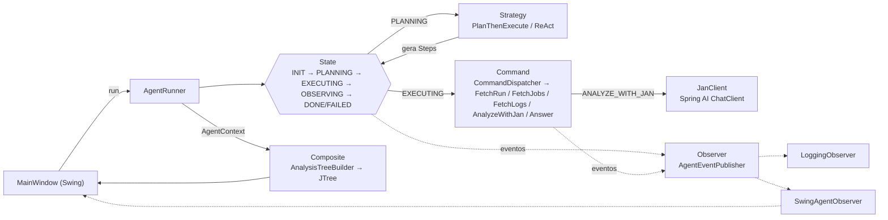
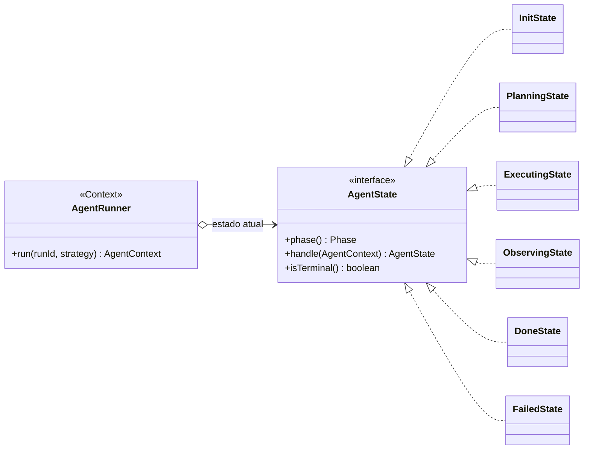
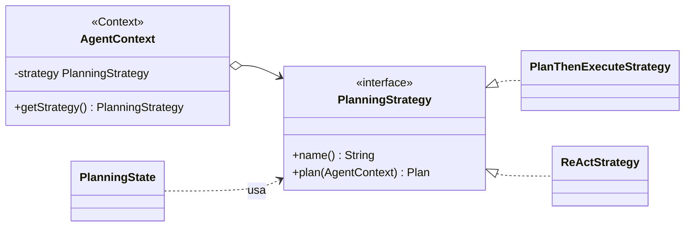
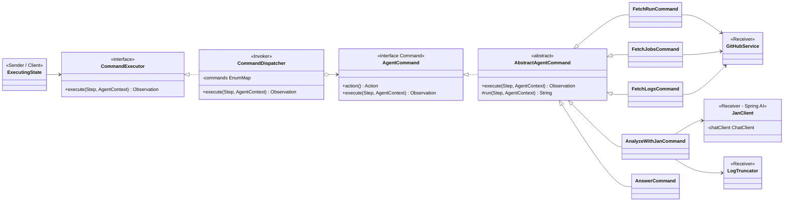
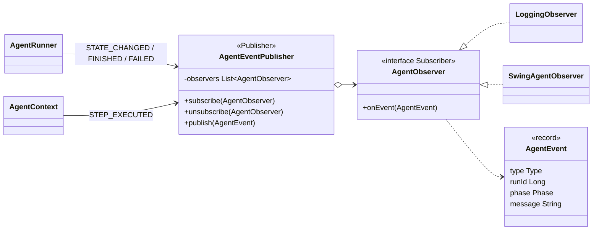
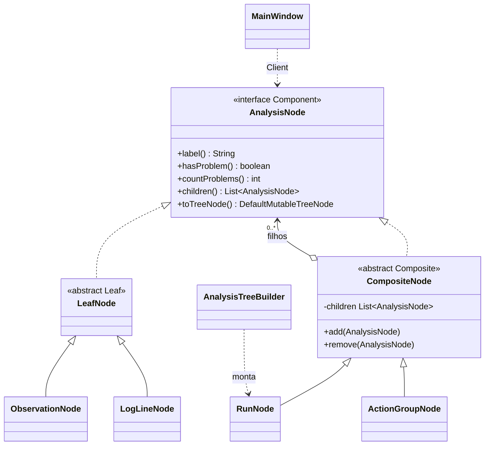

# DevOps Agent

Agente que analisa **builds que falharam no GitHub Actions**. Você informa o ID de uma execução (run); o agente busca a execução, os jobs e o log pela API do GitHub, envia o final do log para um modelo de IA **local** (JAN) via **Spring AI** e devolve o que falhou, a causa provável e como corrigir.

Projeto da disciplina do professor Bertoti (FATEC São José dos Campos), com os padrões **State, Strategy, Command e Observer** (com Spring AI) e **Composite** (com Java Swing).

**Stack:** Java 17 · Spring Boot 4.1 · Spring AI 2.0 · Java Swing · JAN (modelo local, API compatível com OpenAI)

---

## Como rodar

### 1. Pré-requisitos

| Item | Como conferir |
|---|---|
| Java 17 ou mais | `java -version` |
| [JAN](https://jan.ai) com o modelo `Jan-code-4b-Q4_K_XL` | Em **Settings → Local API Server**: API Key `local` e **Start Server** |
| Token do GitHub (classic, escopo `repo`) | [github.com/settings/tokens/new](https://github.com/settings/tokens/new) |

Para testar o JAN:
```powershell
curl.exe http://127.0.0.1:1337/v1/models -H "Authorization: Bearer local"
```

### 2. Arquivo `.env`

Copie o `env.example` para `.env`, na raiz do projeto, e preencha o token. O Spring lê esse arquivo (`spring.config.import`), e o `.gitignore` impede que ele vá para o GitHub.

```properties
GITHUB_TOKEN=ghp_seu_token
GITHUB_ORGANIZATION=AtlazDB
GITHUB_REPOSITORY=devops-agent
```

### 3. Subir

```powershell
.\mvnw.cmd spring-boot:run
```

A janela Swing abre sozinha. Para rodar só a API, sem a janela: `$env:AGENT_GUI="false"` antes do comando.

### 4. Usar

| Forma | Como |
|---|---|
| Janela Swing | Digite o Run ID, escolha a estratégia e clique em **Analisar** |
| API | `GET http://localhost:8080/api/agent/analisar/{runId}?strategy=react` (o `strategy` é opcional; o padrão é `plan-then-execute`) |

Exemplo com uma run real que falhou: `33537076509`. A resposta da IA local leva de 1 a 3 minutos.

### 5. Testes

```powershell
.\mvnw.cmd test "-Dtest=AgentRunnerTest,AgentEventPublisherTest"
```

---

## Arquitetura

### Como os padrões se conectam



---


| Padrão | Pacote | Papel no agente |
|---|---|---|
| State | `agent/state/` | Ciclo de vida: INIT → PLANNING → EXECUTING → OBSERVING → DONE / FAILED |
| Strategy | `agent/strategy/` | Como planejar: `plan-then-execute` (tudo de uma vez) ou `react` (um passo por vez) |
| Command | `agent/command/` | Cada ação (buscar run, jobs, log, analisar, responder) é um objeto; `CommandDispatcher` é o Invoker |
| Observer | `agent/observer/` | `AgentEventPublisher` avisa os inscritos (log e tela) a cada estado e a cada comando |
| Composite | `gui/composite/` | O resultado vira uma árvore (Run → ações → resultados → linhas do log) num `JTree` |

### Diagramas de classes (formato refactoring.guru)

#### State



#### Strategy



#### Command



#### Observer



#### Composite



A explicação de cada padrão (problema, solução e papéis) está na pasta `padrões` do repositório individual de cada integrante.

---

## Estrutura

```
src/main/java/br/com/fatec/devopsagent/
├── agent/
│   ├── state/       State
│   ├── strategy/    Strategy
│   ├── command/     Command
│   └── observer/    Observer
├── gui/
│   └── composite/   Composite (Java Swing)
├── service/         GitHubService, JanClient (Spring AI), LogTruncator
├── controller/      API REST
├── entity/          Records da API do GitHub e AnaliseResponse
└── config/          GitHubConfig
```

## Endpoints

| Método | Caminho | Descrição |
|---|---|---|
| GET | `/api/agent/analisar/{runId}?strategy=` | Roda o agente |
| GET | `/api/runs/ids` | IDs das últimas runs |
| GET | `/api/runs/{runId}` | Dados de uma run |
| GET | `/api/runs/{runId}/jobs` | Jobs de uma run |
| GET | `/api/jobs/{jobId}/logs` | Log de um job |
| GET | `/jan/teste` | Testa a conexão com o JAN |

## Problemas comuns

| Sintoma | Solução |
|---|---|
| `Bad credentials` | Token errado ou `.env` com aspas e espaços |
| `Connection refused` na porta 1337 | Iniciar o servidor do JAN |
| `Port 8080 was already in use` | Outra instância está rodando |
| `log vazio` | Corrigido: o `GitHubService` segue o redirecionamento 302 do GitHub |
